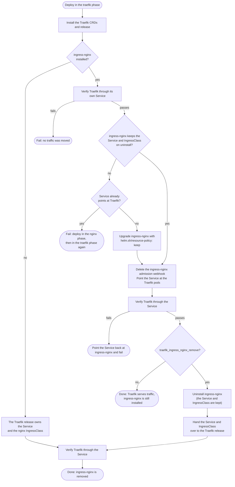

# Migrating from ingress-nginx to Traefik

The `traefik` role replaces ingress-nginx with [Traefik](https://traefik.io/), without changing
any Ingresses and without moving the load balancer.
Traefik's [ingress-nginx provider](https://doc.traefik.io/traefik/reference/install-configuration/providers/kubernetes/kubernetes-ingress-nginx/)
serves the existing `nginx`-class Ingresses.
The ingress-nginx controller Service, is reused by pointing its selector at the Traefik pods.

## Settings

| Variable | Default | Description |
| --- | --- | --- |
| `ingress_controller_migration_phase` | `nginx` | `nginx` or `traefik`. Selects the ingress controller that serves traffic. |
| `traefik_ingress_nginx_remove` | `false` | In the `traefik` phase, uninstall ingress-nginx. Rolling back after this is a manual operation. |

## Procedure

1. **Deploy with `ingress_controller_migration_phase: traefik`.** Traefik is installed alongside
   ingress-nginx and verified. The Service is then pointed at Traefik and verified again; if that
   fails, it is pointed back at ingress-nginx and the deploy fails. ingress-nginx keeps running,
   but receives no traffic.
2. **Test the deployment.** To roll back, deploy in the `nginx` phase again.
3. **Deploy with `traefik_ingress_nginx_remove: true`** as well. ingress-nginx is uninstalled,
   and the Traefik release takes over the Service and the `nginx` IngressClass.

Steps 1 and 3 can be done in one deploy, by setting both variables at once. But once nginx is removed,
rolling back is no longer possible.

## What a deploy in the `traefik` phase does

### Verification

Traefik is checked in two ways, retrying for up to a minute:

- **Routers and middlewares:** the Traefik API on each pod, reached through the Kubernetes API
  server, must report no disabled routers or middlewares.
  A disabled one means the Ingress uses a feature that the ingress-nginx provider does not support.
- **Requests:** each probe URL is requested through the Service's ClusterIP.

## Rolling back

Until ingress-nginx is removed, deploying in the `nginx` phase points the Service back at
ingress-nginx, uninstalls Traefik, and restores the admission webhook and the ingress-nginx
values without the keep annotation.

After ingress-nginx is removed, a deploy in the `nginx` phase fails without changing anything,
because the Service belongs to the Traefik release. Rolling back is then a manual operation.

## Fresh installs

With `ingress_controller_migration_phase: traefik` and no ingress-nginx, Traefik is installed into
the `traefik` namespace, with a LoadBalancer Service from the chart. The Traefik release also creates
the `nginx` IngressClass, so Ingresses that ask for it are served.

A migrated install looks different: Traefik stays in the `ingress-nginx` namespace, because a
Service can only select pods in its own namespace, and the Service keeps the name
`ingress-nginx-controller`.
