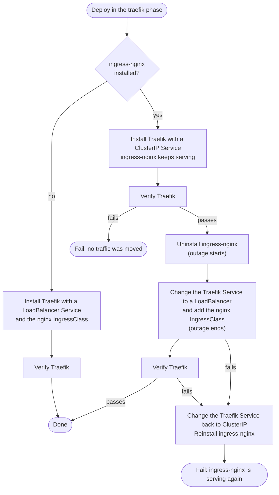

# Migrating from ingress-nginx to Traefik

The `traefik` role replaces ingress-nginx with [Traefik](https://traefik.io/), without changing
any Ingresses.
Traefik's [ingress-nginx provider](https://doc.traefik.io/traefik/reference/install-configuration/providers/kubernetes/kubernetes-ingress-nginx/)
serves the existing `nginx`-class Ingresses.
Once Traefik is verified, ingress-nginx is uninstalled and Traefik's Service takes over the load
balancer, with a short outage.

## Settings

| Variable | Default | Description |
| --- | --- | --- |
| `ingress_controller_migration_phase` | `nginx` | `nginx` or `traefik`. Selects the ingress controller that serves traffic. |

## Procedure

1. **Deploy with `ingress_controller_migration_phase: traefik`.**
    * Traefik is installed alongside ingress-nginx and verified.
    * ingress-nginx is uninstalled
    * Traefik takes over the load balancer
    * Traefik is verified again.
    * If that fails, ingress-nginx is reinstalled and the deploy fails.

2. **Test the deployment.** To roll back, deploy in the `nginx` phase again.

Requests fail while the load balancer moves between the controllers, in the cutover and in a
rollback, and websockets are disconnected.

## What a deploy in the `traefik` phase does

### Moving the load balancer

On a single-node install, k3s exposes a LoadBalancer Service by binding ports 80 and 443 on the
node, and only one Service can hold them. So the Traefik Service is ClusterIP while ingress-nginx
is installed, and becomes a LoadBalancer once ingress-nginx is removed. The IP doesn't change.

The `nginx` IngressClass is deleted with ingress-nginx, and the Traefik release creates it again.

### Verification

Traefik is checked in two ways, retrying for up to a minute:

- **Routers and middlewares:** the Traefik API on each pod, reached through the Kubernetes API
  server, must report no disabled routers or middlewares.
  A disabled one means the Ingress uses a feature that the ingress-nginx provider does not support.
- **Requests:** each probe URL is requested through the Traefik Service's ClusterIP.

## Rolling back

Deploying in the `nginx` phase uninstalls Traefik and reinstalls ingress-nginx, which takes the
load balancer back. This works at any time.

## Fresh installs

With `ingress_controller_migration_phase: traefik` and no ingress-nginx, Traefik is installed with
a LoadBalancer Service and the `nginx` IngressClass, the same as a migrated install.
